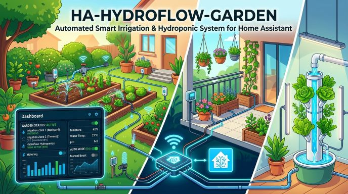

# HydroFlow Garden: Smart and Unlimited

[](https://raw.githubusercontent.com/shakin89/ha-hydroflow-garden/main/docs/images/HA-HydroFlow-Garden.jpeg)

 [Read in English](README.md)

**HydroFlow Garden unisce [Irrigation Unlimited](https://github.com/rgc99/irrigation_unlimited) e
[Smart Irrigation](https://github.com/jeroenterheerdt/HAsmartirrigation) in un unico sistema di
irrigazione, configurato e gestito dall'interfaccia di Home Assistant.**

- **Irrigation Unlimited** è un ottimo scheduler e sequenziatore di valvole. Però non sa quanta acqua
  serve alle piante, e si configura in YAML.
- **Smart Irrigation** calcola quanto deve irrigare ogni zona in base a meteo ed evapotraspirazione. Però
  non comanda le valvole seguendo una tua programmazione a più zone.

Per farli lavorare insieme di solito servono molte automazioni scritte a mano: copiare le durate in IU
prima di ogni corsa, azzerare i bucket dopo, gestire pioggia, device offline e notifiche.
HydroFlow Garden è quello strato mancante, realizzato come integrazione nativa.

## Punti di forza

- **Controller illimitati**, ognuno con **fino a 99 zone** e **fino a 9 programmi**, quindi fino a 9
  partenze diverse al giorno per controller.
- **Tutto programmabile da UI.** Per ogni programma imposti l'orario (fisso, alba o tramonto con
  offset), i mesi attivi e i cicli eco; per ogni zona i suoi giorni della settimana e la sua durata.
  HydroFlow Garden li invia a Irrigation Unlimited tramite le sue azioni, senza scrivere file, e
  garantisce che le zone dello stesso programma non si aprano mai insieme.
- **Smart Irrigation integrato.** Prima di ogni programma le durate calcolate da Smart Irrigation vengono
  inviate a IU. Dopo la corsa il bucket di una zona viene azzerato solo se la zona ha erogato almeno il
  90% del previsto e il device delle valvole era online.
- **Gestione della pioggia.** Ogni giorno legge la previsione e sospende i controller attivi se
  probabilità e millimetri previsti superano **entrambi** le tue soglie. Una corsa schedulata che parte
  mentre piove viene annullata.
- **Protezione device offline (preflight).** Se il controller delle valvole (es. ESPHome) è offline
  prima di una corsa, HydroFlow Garden lo attende, poi sospende o annulla la corsa. Nessun bucket viene
  azzerato per acqua mai erogata.
- **Riempimento cisterna.** Accende una pompa o una valvola di carico N minuti prima di ogni programma,
  per M minuti.
- **Notifiche e log eventi.** I messaggi di avvio, fine, annullamento, pioggia e guasti arrivano a entità
  notify, app mobile o notifiche persistenti. Ogni valvola e ogni corsa finiscono anche in un log
  testuale con rotazione.
- **Dashboard generata.** Una dashboard pronta, riscritta in automatico a ogni modifica della
  configurazione: quattro viste per impianto (*Oggi*, *Programmi*, *Zone*, *Impostazioni*), con tre temi
  colore (*Salvia*, *Laguna*, *Terracotta*) o il tema di Home Assistant, in chiaro, scuro o come Home
  Assistant.

## Requisiti

| Obbligatorio | A cosa serve |
|---|---|
| [Irrigation Unlimited](https://github.com/rgc99/irrigation_unlimited) | Comanda le valvole. La sua configurazione deve essere inclusa da file: `irrigation_unlimited: !include irrigation_unlimited.yaml`. HydroFlow Garden ti dà il contenuto da incollare in quel file e non lo scrive mai. |
| [button-card](https://github.com/custom-cards/button-card) | Dashboard generata (tutte le card sono button-card) |

| Facoltativo | A cosa serve |
|---|---|
| [Smart Irrigation](https://github.com/jeroenterheerdt/HAsmartirrigation) | Durate per zona calcolate dal meteo |
| [apexcharts-card](https://github.com/RomRider/apexcharts-card) | Grafico storico nella vista *Zone*. Senza, il grafico non viene mostrato. |
| Un'entità `weather` con previsioni giornaliere | Skip pioggia giornaliero e sensori di previsione |

## Installazione

1. Marketplace / HACS → ⋮ → **Repository personalizzati** → `https://github.com/shakin89/ha-hydroflow-garden`,
   categoria **Integrazione** → installa → riavvia Home Assistant.
2. Verifica che `configuration.yaml` contenga `irrigation_unlimited: !include irrigation_unlimited.yaml`.
   Il contenuto di quel file lo incolli al passo 4.
3. Impostazioni → Dispositivi e servizi → **Aggiungi integrazione** → *HydroFlow Garden*.

## Come si usa

1. **Impostazioni generali.** Il primo form imposta notifiche, meteo e soglie pioggia, file di log e
   dashboard. Per ora lascia spento **Engine attivo**. Tutti i campi sono spiegati qui sotto.
2. **Aggiungi un controller.** Dalla pagina dell'integrazione scegli **Aggiungi controller**: un
   controller è un impianto con la sua pompa e le sue valvole. Inserisci le zone (una per valvola) e i
   programmi (una partenza giornaliera ciascuno). Sotto ogni campo c'è una spiegazione.
3. **Apri la dashboard** dalla barra laterale (*Irrigazione* per default, nella lingua di Home Assistant). Per ogni programma imposta:
   - l'orario;
   - i mesi attivi;
   - i cicli eco;
   - per ogni zona, i giorni e la durata.
4. **Accendi l'engine.** Pagina dell'integrazione → **Configura** → *Engine attivo*. Un avviso di
   riparazione (Impostazioni → **Riparazioni**) mostra la configurazione di Irrigation Unlimited.
   Incollala come contenuto di `irrigation_unlimited.yaml`, poi esegui l'azione *Irrigation Unlimited:
   Reload*. L'avviso sparisce quando IU la usa. Da quel momento ogni modifica in dashboard arriva a IU
   in circa 5 secondi. L'azione `hydroflow_garden.get_iu_config` restituisce lo stesso testo.
5. **Prova.** Il pulsante **Avvia test** di un controller (`button.iu_<c>_test`, nella pagina del suo
   dispositivo) fa girare tutte le zone per la durata di test. Per ora non è nella dashboard.

Per cambiare zone o programmi in seguito usa **Riconfigura** sul controller. La dashboard si rigenera da
sola.

### Il file di Irrigation Unlimited

HydroFlow Garden non scrive mai file. Il testo che incolli descrive solo la struttura: impianti, zone e,
per ogni programma, fino a 7 sequenze (una per insieme di zone), tutte disabilitate. Orari, giorni, mesi, durate e quali zone
partono vengono inviati a runtime con le azioni di IU, e inviati di nuovo dopo ogni riavvio e reload di
IU. Incolla un nuovo testo solo quando lo chiede l'avviso di riparazione: dopo aver aggiunto, tolto o
rinominato zone o programmi, o cambiato cicli o pausa eco. Fino ad allora quegli impianti non ricevono
aggiornamenti.

Le durate sono impostate sulle zone di ogni sequenza. HydroFlow Garden azzera gli aggiustamenti di zona
fatti in IU a ogni riavvio e reload di IU, perché IU li ignora dentro una sequenza che ha i propri.

Fino alla 0.4.0-beta.2 l'integrazione scriveva lei questo file. Dopo l'aggiornamento l'avviso di
riparazione compare una volta: incolla il nuovo testo e ricarica IU.

### Impostazioni generali (Configura)

| Campo | Significato |
|---|---|
| Engine attivo | Spento: solo entità, niente viene inviato a IU o eseguito. Acceso: invia orari, giorni e durate a IU ed esegue tutte le automazioni. |
| Entità notify | Entità chiamate con `notify.send_message`, es. un bot Telegram. |
| Servizi notify legacy | Nomi completi dei servizi, es. `notify.mobile_app_telefono`. |
| Notifiche persistenti | Mostra ogni messaggio anche come notifica persistente. |
| Entità meteo | Previsione giornaliera con `precipitation` (mm) e `precipitation_probability` (%). Abilita lo skip pioggia. |
| Entità pioggia in corso | Qualsiasi entità che indichi che sta piovendo adesso. Una corsa schedulata che parte mentre piove viene annullata. |
| Stato che indica pioggia | Stato di quell'entità che significa pioggia (`on` per un binary sensor, `rain` per una condizione meteo…). |
| Salta con probabilità / …e con pioggia | La giornata viene saltata se **entrambe** probabilità e mm di oggi raggiungono questi valori. |
| Ora controllo previsione | Quando gira il controllo giornaliero. Mettila prima del programma più mattutino. |
| Durata sospensione | Ore di sospensione dei controller attivi dopo uno skip pioggia. |
| File di log eventi, Ruota il log oltre, Copie ruotate | Log eventi testuale e sua rotazione per dimensione. |
| URL dashboard, Titolo dashboard | Dove sta la dashboard generata e il suo nome nella barra laterale. L'URL deve contenere un trattino. Una dashboard già presente su quell'URL e non creata dall'integrazione non viene mai sovrascritta: un avviso di riparazione chiede un altro URL. |

### Controller (Aggiungi controller / Riconfigura)

| Campo | Significato |
|---|---|
| Nome | Mostrato in dashboard e nelle notifiche. |
| Id | Slug breve in ogni entity id (`switch.iu_<id>_…`). Non si cambia dopo; vuoto = dal nome. |
| controller_id IU | `controller_id` nella configurazione di IU; vuoto = dal nome. |
| Pompa / valvola master | Switch che IU accende mentre una zona di questo controller irriga. |
| Durata massima zona | Limite di sicurezza per una corsa di zona (`HH:MM`). |
| Zone | Una riga per valvola (vedi sotto). |
| Programmi | Una riga per partenza giornaliera, fino a 9 (vedi sotto). |
| Switch riempimento cisterna | Switch facoltativi accesi prima di ogni programma per riempire una cisterna. |
| Anticipo / Durata riempimento | Facoltativi, solo con gli switch di riempimento. Valori predefiniti di quando parte il riempimento e quanto dura (modificabili poi in dashboard). |
| Connettività device valvole | `binary_sensor` facoltativo, `on` quando il controller delle valvole è online. Abilita il preflight. |
| Attesa preflight | Minuti predefiniti prima dell'avvio in cui il device viene controllato e atteso. |

**Riga zona**

| Campo | Significato |
|---|---|
| Id zona | 1–99, fisso. Cambiarlo crea una zona nuova. |
| Nome | Es. *Prato*. |
| Valvola | Switch o valve che apre la zona. |
| Sensore Smart Irrigation | Facoltativo. Il suo valore diventa la durata della zona prima di ogni corsa. |

**Riga programma**

| Campo | Significato |
|---|---|
| Id programma | 1–9, fisso. |
| Nome | Es. *Mattina*. |
| Orario predefinito | Orario iniziale. Si cambia poi dalla dashboard. |

## Entità

Ogni valore è un'entità con id stabile: `iu_<controller>_…`.

| Entità | A cosa serve |
|---|---|
| `switch.iu_<c>_system_enabled` | Controller acceso/spento |
| `switch.iu_<c>_adjust_rain`, `_logging`, `_notifications`, `_preflight` | Funzioni per controller |
| `switch.iu_<c>_p<N>_enabled`, `_eco`, `_<mese>` | Programma attivo, eco, mesi attivi |
| `switch.iu_<c>_p<N>_z<Z>_enabled`, `_z<Z>_<giorno>` | Zona nel programma e suoi giorni |
| `number.iu_<c>_p<N>_z<Z>_duration` | Durata zona (min) |
| `time.iu_<c>_p<N>_time`, `select.iu_<c>_p<N>_time_type`, `number.iu_<c>_p<N>_offset` | Partenza: `fixed` (fisso), `sunrise` (alba) o `sunset` (tramonto) ± offset |
| `number.iu_<c>_p<N>_eco_cycles`, `_eco_soak` | Cicli eco e pausa tra un ciclo e l'altro (s, anche negativa) |
| `number.iu_<c>_fill_lead_minutes`, `_fill_duration_minutes`, `_preflight_timeout_minutes`, `iu_si_adjust_lead_minutes` | Anticipi e durate |
| `sensor.iu_<c>_suspend_reason` | Motivo della sospensione: `none`, `rain`, `device_offline` |
| `sensor.iu_<nome controller>_z<Z>_<zona>_programmato` / `_oggi` / `_ieri` / `_2gg_fa` | Prossima durata prevista con i dettagli di Smart Irrigation; tempo irrigato oggi, ieri e 2 giorni fa |
| `sensor.precipitazioni_oggi`, `sensor.probabilita_pioggia_oggi`, `binary_sensor.iu_sta_piovendo` | Previsione e pioggia in corso |
| `button.iu_<c>_test`, `button.iu_regenerate_dashboard` | Test, manutenzione |
| `select.iu_dashboard_theme`, `select.iu_dashboard_mode` | Colori della dashboard: `system`, `salvia`, `laguna`, `terracotta`; `auto`, `light`, `dark` |

## Lingue

L'interfaccia segue la lingua di Home Assistant: italiano e inglese, inglese per tutte le altre lingue.
Vale per nomi delle entità, opzioni dei select, form di configurazione, notifiche e dashboard generata.
Se la lingua di Home Assistant cambia, l'integrazione si ricarica e rigenera la dashboard.

Gli stati sono codici indipendenti dalla lingua (`fixed`, `sunrise`, `sunset`; `none`, `rain`,
`device_offline`; `next`, `history`, `smart`, `timeline`) e Home Assistant li mostra tradotti. Le
automazioni devono usare i codici. Prima della 0.3 questi stati erano etichette in italiano (*Fisso*,
*Pioggia*…): i valori salvati vengono convertiti al primo avvio, le automazioni che li confrontano vanno
aggiornate a mano.

Per aggiungere una lingua vedi `scripts/build_translations.py`.

## Azioni

- `hydroflow_garden.regenerate_dashboard`
- `hydroflow_garden.get_iu_config`: restituisce il testo del file di IU da incollare (`yaml`) e gli
  impianti che lo usano già (`in_sync`).
- `hydroflow_garden.rain_skip`: esegue subito il controllo pioggia. Con `force: true` sospende comunque, per prova.

## Migrazione da helper YAML

Al primo avvio ogni valore prende lo stato dell'helper `input_*` con lo stesso object_id, se esiste.
Si può anche importare una topologia intera, una volta sola, da `configuration.yaml`; il blocco va tolto
dopo il primo avvio:

```yaml
hydroflow_garden:
  options:
    engine_enabled: false
  controllers:
    - id: giardino
      name: Giardino
      entity_id: switch.pompa
      zones:
        - {id: 1, name: Prato, entity_id: switch.valvola_1, si_sensor: sensor.smart_irrigation_prato}
        - {id: 2, name: Aiuole, entity_id: switch.valvola_2}
      programs:
        - {id: 1, name: Mattina, default_time: "06:00"}
      fill_switches: [switch.riempimento]
      availability_entity: binary_sensor.valvole_status
  values:            # facoltativo: valori iniziali per object_id
    iu_giardino_p1_z1_mon: true
```

Note di progetto: [docs/CONTEXT.it.md](docs/CONTEXT.it.md).
