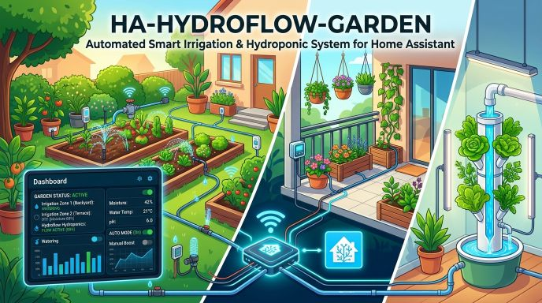

# HydroFlow Garden: Smart and Unlimited

[](https://raw.githubusercontent.com/shakin89/ha-hydroflow-garden/main/docs/images/HA-HydroFlow-Garden.jpeg)

 [Leggi in italiano](README.it.md)

**HydroFlow Garden joins [Irrigation Unlimited](https://github.com/rgc99/irrigation_unlimited) and
[Smart Irrigation](https://github.com/jeroenterheerdt/HAsmartirrigation) into one irrigation system you
configure and run from the Home Assistant UI.**

- **Irrigation Unlimited** is a solid scheduler and valve sequencer. It does not know how much water your
  plants need, and you configure it in YAML.
- **Smart Irrigation** calculates how long each zone should water from weather and evapotranspiration. It
  does not drive your valves on your own multi-zone schedule.

Making the two work together usually takes a pile of hand-written automations: copy durations into IU
before each run, reset buckets afterwards, and handle rain, offline devices and notifications.
HydroFlow Garden is that missing layer, built as a native integration.

## Highlights

- **Unlimited controllers**, each with **up to 99 zones** and **up to 9 programs**, so up to 9 separate
  start times a day per controller.
- **Everything programmable from the UI.** For every program you set the start time (fixed, sunrise or
  sunset with an offset), the active months and eco cycles, and for every zone its own weekdays and
  duration. HydroFlow Garden turns this into a valid Irrigation Unlimited configuration. It
  guarantees that zones of the same program never open together.
- **Smart Irrigation in the loop.** Before each program, the Smart Irrigation durations are written to
  IU. After the run, a zone's bucket is reset only if it delivered at least 90% of the plan with its
  valve device online.
- **Rain aware.** Every day it reads the forecast and suspends the active controllers when the
  probability and the expected mm are both over your thresholds. A scheduled run that starts while it
  rains is cancelled.
- **Device-offline protection (preflight).** If the valve controller (for example ESPHome) is offline
  before a run, HydroFlow Garden waits for it, then suspends the run or cancels it. No bucket is reset
  for water that was never delivered.
- **Cistern fill.** Turns a fill pump or valve on N minutes before each program, for M minutes.
- **Notifications and an event log.** Start, finish, cancel, rain and fault messages go to notify
  entities, mobile apps or persistent notifications. Every valve and run is also written to a plain text
  log with rotation.
- **Generated dashboard.** A ready-made storage dashboard, rewritten automatically whenever the
  configuration changes: four views per controller (*Today*, *Programs*, *Zones*, *Settings*), with
  three colour themes (*Salvia*, *Laguna*, *Terracotta*) or the Home Assistant theme, each light, dark
  or following Home Assistant.

## Requirements

| Required | What for |
|---|---|
| [Irrigation Unlimited](https://github.com/rgc99/irrigation_unlimited) | Runs the valves. Its configuration must be included from a file: `irrigation_unlimited: !include irrigation_unlimited.yaml`. **HydroFlow Garden owns and overwrites that file.** |
| [button-card](https://github.com/custom-cards/button-card) | Generated dashboard (every card is a button-card) |

| Optional | What for |
|---|---|
| [Smart Irrigation](https://github.com/jeroenterheerdt/HAsmartirrigation) | Weather-based durations per zone |
| [apexcharts-card](https://github.com/RomRider/apexcharts-card) | History chart in the *Zones* view. Without it the chart is left out. |
| A `weather` entity with daily forecasts | Daily rain skip and the forecast sensors |

## Installation

1. Marketplace / HACS → ⋮ → **Custom repositories** → `https://github.com/shakin89/ha-hydroflow-garden`,
   category **Integration** → install → restart Home Assistant.
2. Make sure `configuration.yaml` contains `irrigation_unlimited: !include irrigation_unlimited.yaml`.
3. Settings → Devices & services → **Add integration** → *HydroFlow Garden*.

## How to use

1. **Global settings.** The first form sets notifications, weather and rain thresholds, the log file,
   the IU file and the dashboard. Leave **Engine active** off for now. Every field is explained below.
2. **Add a controller.** On the integration page choose **Add controller**: one controller is one
   system with its own pump and valves. Fill in its zones (a valve each) and its programs (a daily start
   each). Every field has a help text under it.
3. **Open the dashboard** from the sidebar (*Irrigation* by default, in the language of Home Assistant). For each program, set:
   - the start time;
   - the active months;
   - eco cycles;
   - for each zone, the weekdays and the duration.
4. **Turn the engine on.** Integration page → **Configure** → *Engine active*. The IU file is written,
   IU reloads, and from then on every change in the dashboard reaches IU within about 5 seconds.
5. **Test.** The **Start test** button of a controller (`button.iu_<c>_test`, on its device page) runs
   every zone for the test duration. It is not in the dashboard for now.

To change zones or programs later, use **Reconfigure** on the controller. The dashboard is regenerated
automatically.

### Global settings (Configure)

| Field | Meaning |
|---|---|
| Engine active | Off: entities only, nothing is written or triggered. On: writes the IU file and runs every automation. |
| Notify entities | Entities called with `notify.send_message`, e.g. a Telegram bot. |
| Legacy notify services | Full service names, e.g. `notify.mobile_app_my_phone`. |
| Persistent notifications | Also show each message as a persistent notification. |
| Weather entity | Daily forecast with `precipitation` (mm) and `precipitation_probability` (%). Enables the rain skip. |
| Raining-now entity | Any entity telling that it rains right now. A scheduled run starting while it rains is cancelled. |
| Raining state | The state of that entity meaning rain (`on` for a binary sensor, `rain` for a weather condition…). |
| Skip at probability / …and at rain | The day is skipped when **both** today's probability and today's mm reach these values. |
| Forecast check time | When the daily check runs. Put it before your earliest program. |
| Suspension length | Hours the active controllers stay suspended after a rain skip. |
| Event log file, Rotate log above, Rotated copies | Plain text event log and its size-based rotation. |
| Irrigation Unlimited file | The file included as `irrigation_unlimited:`. It is overwritten. |
| Dashboard URL, Dashboard title | Where the generated dashboard lives and its sidebar name. The URL must contain a dash. |

### Controller (Add controller / Reconfigure)

| Field | Meaning |
|---|---|
| Name | Shown in the dashboard and in notifications. |
| Id | Short slug in every entity id (`switch.iu_<id>_…`). Cannot change later; empty = from the name. |
| IU controller_id | `controller_id` written to the IU file; empty = from the name. |
| Pump / master valve | Switch IU turns on while any zone of this controller waters. |
| Max zone run | Safety cap for one zone run (`HH:MM`). |
| Zones | One row per valve (see below). |
| Programs | One row per daily start, up to 9 (see below). |
| Cistern fill switches | Optional switches turned on before each program to fill a tank. |
| Fill lead / Fill duration | Defaults for when the fill starts and how long it lasts (adjustable later from the dashboard). |
| Valve device connectivity | Optional `binary_sensor` that is `on` while the valve controller is online. Enables preflight. |
| Preflight wait | Default minutes before the start at which the device is checked and waited for. |

**Zone row**

| Field | Meaning |
|---|---|
| Zone id | 1–99, fixed. Changing it creates a new zone. |
| Name | E.g. *Lawn*. |
| Valve | Switch or valve opening this zone. |
| Smart Irrigation sensor | Optional. Its value becomes the zone duration before each run. |

**Program row**

| Field | Meaning |
|---|---|
| Program id | 1–9, fixed. |
| Name | E.g. *Morning*. |
| Default time | Initial start time. You change it later from the dashboard. |

## Entities

Each value is an entity with a stable id: `iu_<controller>_…`.

| Entity | Purpose |
|---|---|
| `switch.iu_<c>_system_enabled` | Controller on/off |
| `switch.iu_<c>_adjust_rain`, `_logging`, `_notifications`, `_preflight` | Per-controller features |
| `switch.iu_<c>_p<N>_enabled`, `_eco`, `_<month>` | Program on/off, eco, active months |
| `switch.iu_<c>_p<N>_z<Z>_enabled`, `_z<Z>_<weekday>` | Zone in the program, its weekdays |
| `number.iu_<c>_p<N>_z<Z>_duration` | Zone duration (min) |
| `time.iu_<c>_p<N>_time`, `select.iu_<c>_p<N>_time_type`, `number.iu_<c>_p<N>_offset` | Start: `fixed`, `sunrise` or `sunset` ± offset |
| `number.iu_<c>_p<N>_eco_cycles`, `_eco_soak` | Eco cycles and the soak between them (s, may be negative) |
| `number.iu_<c>_fill_lead_minutes`, `_fill_duration_minutes`, `_preflight_timeout_minutes`, `iu_si_adjust_lead_minutes` | Leads and durations |
| `sensor.iu_<c>_suspend_reason` | Why the controller is suspended: `none`, `rain`, `device_offline` |
| `sensor.iu_<controller name>_z<Z>_<zone>_programmato` / `_oggi` / `_ieri` / `_2gg_fa` | Next planned duration with Smart Irrigation details; watering time today, yesterday and 2 days ago |
| `sensor.precipitazioni_oggi`, `sensor.probabilita_pioggia_oggi`, `binary_sensor.iu_sta_piovendo` | Forecast and rain now |
| `button.iu_<c>_test`, `button.iu_regenerate_dashboard`, `button.iu_write_config` | Test run, maintenance |
| `select.iu_dashboard_theme`, `select.iu_dashboard_mode` | Dashboard colours: `system`, `salvia`, `laguna`, `terracotta`; `auto`, `light`, `dark` |

## Languages

The interface follows the language of Home Assistant: English and Italian, English for any other
language. That covers entity names, the options of the selects, the setup forms, the notifications and
the generated dashboard. When the language of Home Assistant changes, the integration reloads and
regenerates the dashboard.

States are language-neutral codes (`fixed`, `sunrise`, `sunset`; `none`, `rain`, `device_offline`;
`next`, `history`, `smart`, `timeline`) and Home Assistant shows them translated. Automations must use
the codes. Before 0.3 these states were Italian labels (*Fisso*, *Pioggia*…): stored values are
converted on the first start, automations that compare them must be updated by hand.

To add a language, see `scripts/build_translations.py`.

## Actions

- `hydroflow_garden.regenerate_dashboard`
- `hydroflow_garden.write_iu_config`: rewrites the IU file and reloads IU.
- `hydroflow_garden.rain_skip`: runs the rain check now. With `force: true` it suspends anyway, to test.

## Migrating from YAML helpers

At first start each value takes the state of the `input_*` helper with the same object_id, if one
exists. A whole topology can also be imported once from `configuration.yaml`; remove the block after
the first start:

```yaml
hydroflow_garden:
  options:
    engine_enabled: false
  controllers:
    - id: garden
      name: Garden
      entity_id: switch.pump
      zones:
        - {id: 1, name: Lawn, entity_id: switch.valve_1, si_sensor: sensor.smart_irrigation_lawn}
        - {id: 2, name: Beds, entity_id: switch.valve_2}
      programs:
        - {id: 1, name: Morning, default_time: "06:00"}
      fill_switches: [switch.fill]
      availability_entity: binary_sensor.valves_status
  values:            # optional initial values by entity object_id
    iu_garden_p1_z1_mon: true
```

Design notes: [docs/CONTEXT.md](docs/CONTEXT.md).
